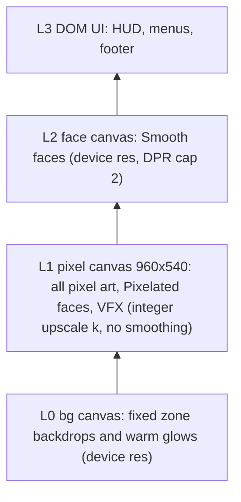
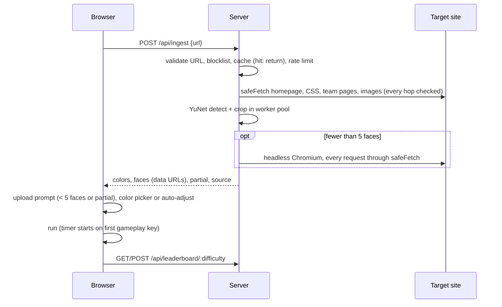

# Architecture

TypeScript everywhere, npm workspaces (`client`, `server`, `shared`). The server runs TypeScript directly with Node 22 type stripping.

## Render layer stack (RND-2, THM-4, THM-5)

- Art grid 480 x 270; every sprite draws at 2x on L1 through `PixelCanvas`, the only L1 writer. Coordinates are rounded to whole pixels there.
- Rotation happens at art resolution (nearest neighbor) before the 2x blit.
- The camera snaps to whole art pixels; L1 and L2 share it.

## Runtime data flow

## Security model

| Threat | Control | Code |
|---|---|---|
| SSRF to internal addresses | Allow-list IP policy (global unicast only, embedded IPv4 forms checked), every DNS answer checked, connect pinned to the checked address, every redirect hop rechecked | `server/src/net/ipPolicy.ts`, `safeFetch.ts` |
| DNS rebinding | Connection uses the validated address, never a second lookup | `safeFetch.ts` (`pinnedAgent`) |
| Browser SSRF | All Chromium requests fulfilled by `safeFetch`; WebSockets closed, service workers blocked, popups closed, dead proxy for escapes, WebRTC UDP off; sandbox on | `server/src/ingest/headless.ts` |
| Resource abuse | Byte caps, 30 s budget, worker pool terminated at the deadline, request and image caps, rate limits | `limits.ts`, `faces/pool.ts`, `policy/rateLimit.ts` |
| Bad image content | `sharp` decode with a 25 MP limit; JPEG, PNG, WebP, GIF only; crops re-encoded as PNG without metadata | `faces/crop.ts` |
| Privacy | Detection only, no recognition model; no names or URLs stored with faces; faces in memory only; blocklist purge | `faces/`, `cache/` |
| Leaderboard | Trust-based by design (C-2): 3-letter filter and positive integer time only | `routes/leaderboard.ts` |

Test-only overrides (resolver, IP policy, detector delay, sandbox off, ingestion budget) exist only as `createApp` code arguments, never as env vars.
